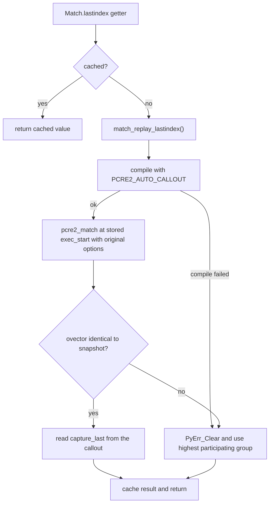
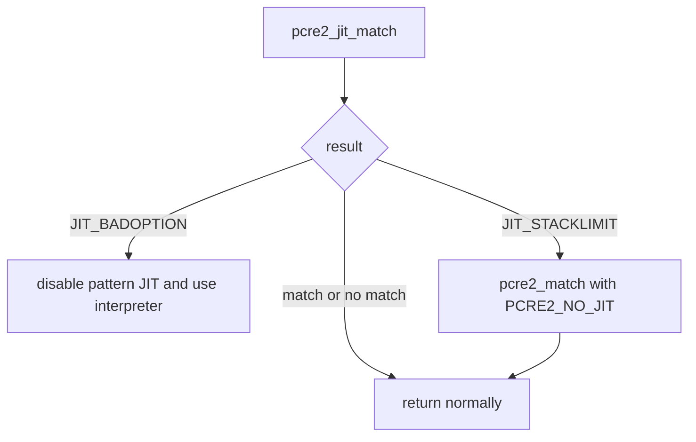

<!--
# SPDX-FileCopyrightText: 2025 ModelCloud.ai
# SPDX-FileCopyrightText: 2025 qubitium@modelcloud.ai
# SPDX-License-Identifier: Apache-2.0
# Contact: qubitium@modelcloud.ai, x.com/qubitium
-->

# `lastindex` replay and JIT stack fallback

This page documents two behaviours that were fixed for
[issue #131](https://github.com/ModelCloud/PyPcre/issues/131):

1. `Match.lastindex` / `Match.lastgroup` no longer raise on valid matches.
2. An exhausted PCRE2 JIT stack no longer surfaces as an exception.

## 1. `lastindex` / `lastgroup` replay

### Symptom

```python
>>> pcre.search(r"(a)\K(b)(c)", "abc").lastindex
PcreErrorNomatch: ('lastindex replay', 'no match')
```

Python's `re` reports the *last* participating capture (`3` here). PyPcre
reconstructs it by recompiling the pattern with `PCRE2_AUTO_CALLOUT` and
replaying the match, because PCRE2 does not expose `capture_last` directly.

### Root cause

The replay (`pcre_ext/pcre2.c`, `match_replay_lastindex`) re-ran the match
**anchored at `ovector[0]`** and synthesised its own match options:

- it added `PCRE2_ANCHORED`, and
- it re-derived the subject length and `PCRE2_NO_UTF_CHECK` instead of using
  the values of the call that produced the snapshot.

`ovector[0]` is the *reported* match start, which `\K` moves to the right of
the engine's real start offset. Anchoring there re-runs the pattern where the
`\K` prefix cannot match, so the replay fails or reproduces a different match
and the attribute getter raises. The same mismatch appears when the original
call used match-time options such as `PCRE2_NOTEMPTY_ATSTART`, and when the
`AUTO_CALLOUT` recompile exceeds PCRE2's pattern-size limit.

### Fix

`MatchObject` now stores the exact call that produced the snapshot — start
offset, subject length and, when `PCRE2_USE_OFFSET_LIMIT` is in play, the
offset limit — and the replay re-runs `pcre2_match` with those values and the
original match options. No `ANCHORED` is added.



If the replay still cannot reproduce the snapshot (pattern too large, a JIT
vs. interpreter difference, or `PCRE2_ERROR_JIT_STACKLIMIT`), the getter
clears the error and degrades to the **highest participating capture group**.
That is exact whenever groups close in index order, and it never raises from
an attribute getter.

## 2. JIT stack exhaustion

### Symptom

```python
>>> pcre.match(r"(a|b)*c", "ab" * 20000 + "c")
PcreErrorJitStacklimit: ('jit_match', 'JIT stack limit reached')
```

The default JIT stack started at 32 KB and was capped at 1 MB
(`pcre_ext/cache.c`). A 40 KB backtracking subject overflows that cap, and the
error escaped from `match`, `finditer`, `findall`, `split` and `sub`.

### Fix

- The default maximum JIT stack is now **8 MB** (the stack still starts at
  32 KB and only grows when needed).
- Every JIT call site treats `PCRE2_ERROR_JIT_STACKLIMIT` as "retry on the
  interpreter": `match`/`search`/`fullmatch`, `finditer`, `findall`, `split`
  and `pcre2_substitute`. The retry passes `PCRE2_NO_JIT` and keeps every
  other option unchanged, so the result is identical to the `Flag.NO_JIT`
  path.



## Semantics and limitations

- `lastindex`/`lastgroup` still follow stdlib `re` semantics for ordinary
  patterns, including `pos`/`endpos` ranges. The differential tests compare
  against `re` for every `pos`/`endpos` pair on a parametrised corpus.
- The highest-participating-group fallback only applies when the exact replay
  is impossible. It is documented here so callers know the degradation mode.
- Raising the JIT stack cap does not change results; the interpreter retry is
  what guarantees correctness when a subject needs more than the cap.

## Verifying

```bash
/opt/venvs/pypcre-b/bin/python -m pytest -q \
  tests/test_lastindex_replay_and_jit_stack_fallback.py
```

Run the same command with the free-threaded interpreter to confirm the fix is
vendor- and GIL-independent.
